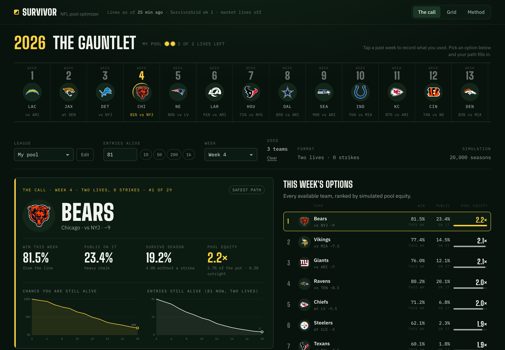

# NFL Survivor Pool Optimizer

**Live:** https://jlattanzi4.github.io/nfl-survivor-optimizer/

Pick the right team every week. A survivor pool is an assignment problem with a
twist: you need to survive, *and* you need most of the pool not to. This tool
solves the first part exactly and simulates the second.



## How it works

1. **Lines, not opinions.** Current-week win probabilities are de-vigged,
   Pinnacle-weighted consensus moneylines from The Odds API. Future weeks use
   SurvivorGrid's look-ahead spreads, converted with a logistic curve calibrated
   to historical straight-up results. Public pick shares come from SurvivorGrid
   (Yahoo / ESPN / OFP pools) for the current week and are projected for future
   weeks with a softmax fit to this week's behavior. Kickoff times and final
   scores come from nflverse: a team can be picked until its game kicks off,
   after which its numbers are frozen at their last pre-game values, and the
   results fill in the weeks already played.
2. **Path search.** Each team can be used once, so the season is an 18-weeks ×
   32-teams assignment. The Hungarian algorithm solves it exactly, minimizing
   `Σ −log p` (which maximizes the product of win probabilities). A leverage
   term `λ·log(field survival)` at λ ∈ {0, ½, 1} also generates paths that lean
   on less popular teams. Every team playing this week is forced into slot one
   and the rest of the season is re-solved around it.
3. **Pool simulation.** Every candidate path is played through 20,000 simulated
   seasons against a field that picks in proportion to public shares. The rank
   metric is **pool equity**: your average share of the pot. It captures why a
   27%-owned favorite can be the wrong pick in a 1,000-entry pool and the right
   one in a 10-entry pool.

**Leagues.** Save any number of pools, each with its own name, entry count,
format and recorded picks, and switch between them. Formats: single
elimination, or two lives (an entry is out on its second loss). In two-lives
mode the simulator tracks strikes for you and for the field, and your own
strikes are counted automatically from the results of the picks you recorded.

**Sync.** Optional magic-link email sign-in (Supabase Auth) keeps leagues the
same on every device. The browser's copy works on its own; once signed in, the
account is the copy every device agrees with. Each sync reads the account,
merges this browser's edits into it week by week (a pick recorded on the phone
and another on the laptop both survive), and writes back only what changed.
Writes are guarded by a revision, so two devices can't overwrite each other
unseen, and a deleted league leaves a tombstone so the delete reaches every
device. Edits are sent when the tab is hidden and picked up when it's shown
again.

The app never creates a league on its own. A setup arriving in a shared link,
or found in a browser that signs in to an account with leagues of its own, is
offered: add it, replace the open league with it, or ignore it.

Rows live in a `survivor_leagues` table protected by row-level security.
Schema in `supabase/schema.sql`; client config in `docs/js/config.js`.

Everything else runs in the browser. There is no app server.

**Data checks.** A scheduled GitHub Action rebuilds the data three times a day.
Each build is validated before it replaces the published file. A record the
page couldn't draw, or a file that doesn't add up (pick shares that don't sum
to one, a team without 17 games, a result that has disappeared), stops the
build and leaves the last good file in place. A cell SurvivorGrid has written
in a way the parser doesn't know is skipped and costs only that game. If the
published data is ever more than 18 hours old, the page says so.

## Architecture

```
pipeline/            Python: fetch + merge sources → docs/data/season.json
  survivorgrid.py    parser (handles neutral-site "(n)" and "PK" cells)
  odds_api.py        de-vigged, Pinnacle-weighted consensus moneylines
  schedule.py        nflverse kickoff times and final scores
  popularity.py      softmax pick-share model for future weeks
  optimizer.py       reference Hungarian path search (parity-tested vs JS)
  simulate.py        reference Monte Carlo pool model (numpy)
  validate.py        checks a build before it replaces the published file
  build.py           CLI entry point
docs/                GitHub Pages site (no build step, no framework)
  js/hungarian.js    rectangular Kuhn–Munkres
  js/optimizer.js    path search
  js/simulate.js     common-random-number pool simulation
  js/engine.js       candidate generation + ranking (runs in a Web Worker)
  js/leagues.js      league rules: what loads, shared links, merging two devices
  js/sync.js         Supabase sign-in and the account's table
  js/freshness.js    when the page says its data is old
  js/app.js          UI
tests/               pytest: parser, odds, optimizer, simulator, JS↔Python parity
tests/js/            node:test: league rules and sync, against an in-memory account
scripts/             JS path dump for the parity test; a replay of the validator over every published build
.github/workflows/   data refresh 3×/day (validates, then commits season.json); lint and tests on push
```

## Run it locally

Needs [uv](https://docs.astral.sh/uv/) and Node 22+.

```bash
uv sync                                       # Python 3.12+ and the locked dependencies
uv run pytest -q
uv run ruff check .
npm test                                      # the browser-side rules
uv run python -m pipeline.build --no-odds     # or set ODDS_API_KEY for market lines
uv run python -m pipeline.validate            # check the data file on its own
npm run serve                                 # then open http://localhost:8765
```

`cp .env.example .env` and add your Odds API key to enable current-week market
lines. On GitHub, add the same key as the `ODDS_API_KEY` repository secret and
the scheduled workflow will use it.

## Modeling notes

- Ties count as losses (and as strikes in two-lives pools).
- Two-lives pools: the field's current strike distribution is an input (entries on their last life); the model does not try to infer it.
- The field is not constrained by teams it has already used; the public burns
  its favorites early, so late-season contrarian picks are worth slightly more
  than shown.
- Small pools are simulated with binomial draws, so variance is real: a pool of
  10 behaves differently from a pool of 10,000 with the same shares.
- Spread → probability: `p = 1 / (1 + 10^(spread/14))` (−3 → 62%, −7 → 76%,
  −10 → 84%).

## License

MIT
